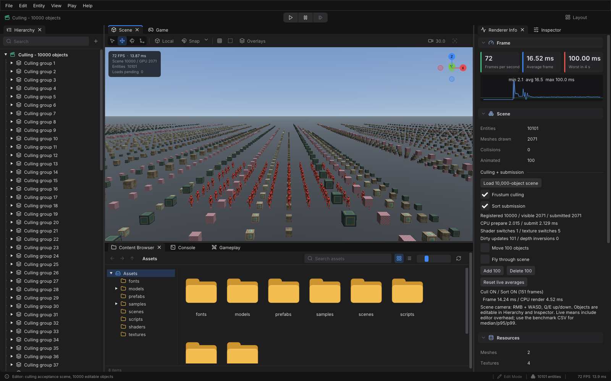

# Вариант Д: Culling + submission

Сцена редактора содержит 10 000 объектов с геометрией: 9 900 кубов и 100 персонажей Walking.fbx. Персонажи анимируются и при выключенном отсеве. Группы в Hierarchy и камеры считаются отдельными ECS-сущностями, поэтому Entities больше 10 000.

Запуск из каталога собранного GameEngine.exe:

```powershell
.\GameEngine.exe --editor-culling --no-vsync
```

Открыть Scene и Renderer Info. ПКМ + WASD управляют камерой, Q/E меняют высоту. Frustum culling и Sort submission переключаются на ходу. Move 100 objects дополнительно перемещает персонажей целиком; скелетная анимация работает независимо от этой галочки. Add 100 / Delete 100 изменяют сцену, Load 10,000-object scene восстанавливает исходный состав.

## Где смотреть реализацию

| Требование | Реализация и проверка |
|---|---|
| Visible set хранится как данные | `RenderSystem::prepare` получает список handles в `visible_`, затем строит `packet_`. `submit` обрабатывает готовый пакет. |
| Stateful-регистрация | `Visibility::Service` владеет bounds и model matrix. `registerObject/update/unregisterObject`, монотонные handles, удаление при `World::destroyEntity`. |
| Без обхода снимка сцены для отсева | `SceneVisibility::synchronize` читает только очередь изменений, затронутых потомков и ожидающие ресурсы. `Service::query` обходит собственный реестр, не обращается к World. Пространственный индекс линейный, O(N). |
| Второй потребитель | `query(viewProjection)` принимает произвольную камеру и не меняет состояние. `VisibilityTests` запрашивает две камеры без перестройки реестра. |
| Сцена не рисует | `CullingScene.cpp` создаёт и меняет компоненты. Графический API и Draw отсутствуют. Отрисовка сосредоточена в RenderSystem и адаптере. |
| Два ключа сортировки | Группировка shader/mesh/texture, затем глубина front-to-back внутри группы. Счётчики texture_changes и depth_inversions показывают эффект отдельно. |
| Анимационные bounds | `SkinBounds.h` один раз строит AABB вершин, на которые влияет каждая кость. На кадре трансформирует эти AABB текущей палитрой и объединяет. Нулевые веса используют mesh-node transform. Некорректные веса включают консервативный fallback. |
| Живые изменения | Проверка редактора использует те же команды, что кнопки: добавление, удаление, движение, полная очистка, повторное добавление и перезагрузка. |

Для неотрицательных нормализованных весов позиция вершины является выпуклой комбинацией её позиций после преобразования костями. Объединённая AABB этих позиций содержит результат skinning. Границы могут быть шире точной геометрии; это допускает лишнюю подачу объектов, но не должно отсекать видимые части. Небольшой запас покрывает округление весов и арифметики CPU/GPU.

Контракт изменений: mutable-доступ к Transform/MeshRenderer/Hierarchy помечает сущность dirty. Читающий код использует const World или forEachRead. При изменении через сохранённую ссылку нужно явно вызвать `markSpatialDirty`. AnimationSystem отмечает обновлённые позы перед синхронизацией. Геометрия загруженного ресурса считается неизменяемой; при её замене нужно сбросить `SubMesh::visibilityBounds`.

## Воспроизведение замеров

Собрать Release с тестами и выполнить:

```powershell
cmake --build build --config Release
ctest --test-dir build -C Release --output-on-failure
python tools/run_culling_bench.py <путь-к-GameEngine.exe> --animated --out docs/culling/animated
```

Скрипт использует только стандартную библиотеку Python. Для каждого из пяти режимов запускает три отдельных процесса, чередуя порядок режимов. Каждый процесс прогревает 120 кадров и записывает 360 кадров. Камера и шаг анимации детерминированы; все 100 персонажей вычисляются во всех режимах. Скрытый framebuffer 1280×720, VSync выключен, `glFinish` перед present исключает накопление очереди GPU. Этот протокол не равен обычной работе редактора.

`frame_ms` содержит полный интервал кадра, включая анимацию и ожидание GPU. `prepare_ms + submit_ms` измеряет CPU-подготовку видимости, bounds, сортировку и подачу команд; отдельное вычисление скелетных поз в эту сумму не входит. Это не GPU time. В редакторе время синхронизации bounds из update добавляется в CPU prepare.

`summary.json` содержит median/p95/p99 по 1 080 измерениям каждого режима и отдельную статистику frame time по каждому прогону. Percentile вычисляется методом nearest-rank. CSV сохраняют исходные данные и параметры видеокарты. Живые средние в панели предназначены для демонстрации и не заменяют эти измерения.

Перед измерениями проверяются 12 позиций камеры и три сочетания culling/sorting относительно режима OFF/OFF: 36 сравнений framebuffer. Вторая половина сценария добавляет и удаляет объекты с поворотом и отрицательным масштабом. В анимированном режиме поза меняется между позициями камеры, но фиксируется внутри каждого сравнения.

Тест WalkingAnimationTests проверяет включение всех деформированных вершин Walking.fbx в bounds на 64 фазах шага. VisibilityTests проверяет две камеры, границы frustum, stale handles, иерархию, загрузку ресурсов, 10 000 статических объектов без повторного обхода сцены и обновление анимированных bounds.

Каталог `animated` содержит итоговую смешанную сцену. `acceptance` содержит более ранние измерения на 10 000 статических кубах; их нельзя выдавать за результаты сцены с персонажами. Локальный каталог `results` содержит промежуточные прогоны и не публикуется.

## Итоговый прогон 20.10.2026

Windows, MSVC Release, NVIDIA GeForce RTX 3050 Laptop GPU, драйвер 617.14, OpenGL 3.3. Три прогона каждого режима, 120 кадров прогрева и 360 измеряемых кадров на прогон.

| Режим | Frame median / p95 / p99, мс | CPU render median / p95 / p99, мс | Переключения текстур, median | Инверсии глубины, median |
|---|---|---|---|---|
| Отсев OFF, сортировка OFF | 21.428 / 25.552 / 28.005 | 18.526 / 22.028 / 24.611 | 10000 | 0 |
| Только сортировка | 20.734 / 25.879 / 27.047 | 16.967 / 19.096 / 20.809 | 16 | 0 |
| Только отсев | 6.695 / 8.577 / 10.966 | 3.891 / 5.241 / 6.653 | 1765.5 | 16.5 |
| Отсев + группировка без глубины | 7.816 / 10.740 / 13.065 | 3.904 / 5.447 / 6.476 | 16 | 989.5 |
| Отсев + полная сортировка | 7.015 / 9.638 / 10.328 | 3.804 / 4.783 / 5.258 | 16 | 0 |

OFF/OFF → ON/ON: медиана полного кадра снизилась с 21,428 до 7,015 мс (в 3,05 раза); CPU render с 18,526 до 3,804 мс (в 4,87 раза). Это сравнение режимов итоговой сборки на смешанной сцене, а не сравнение двух коммитов.

Сортировка сократила переключения текстур до 16, а добавление ключа глубины убрало медианные 989,5 инверсии внутри групп. Полная сортировка не оказалась быстрее режима «только отсев» по медиане полного кадра в этих прогонах. Гарантированного ускорения от каждого ключа отдельно результаты не доказывают.

Все 36 сравнений framebuffer дали different_channels=0 и max_error=0. Все 12 CTest-тестов прошли. Проверки редактора записаны в [editor-check.csv](animated/editor-check.csv): 100 персонажей имеют вычисленные анимационные bounds и участвуют в отсеве; добавление, удаление, движение, очистка и перезагрузка прошли.



На снимке редактора CPU prepare = 2,015 мс, submit = 2,129 мс. Снимок включает недавнюю перезагрузку сцены, поэтому значения FPS и Worst in 4 s не являются результатом прогретого бенчмарка. Надпись справа в верхней строке меню удалена.
